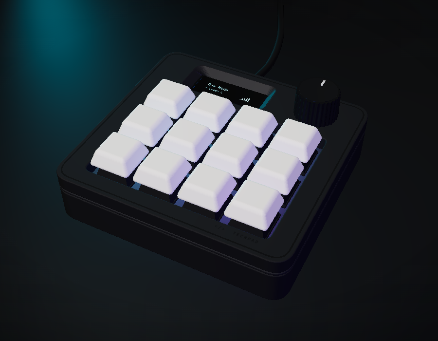
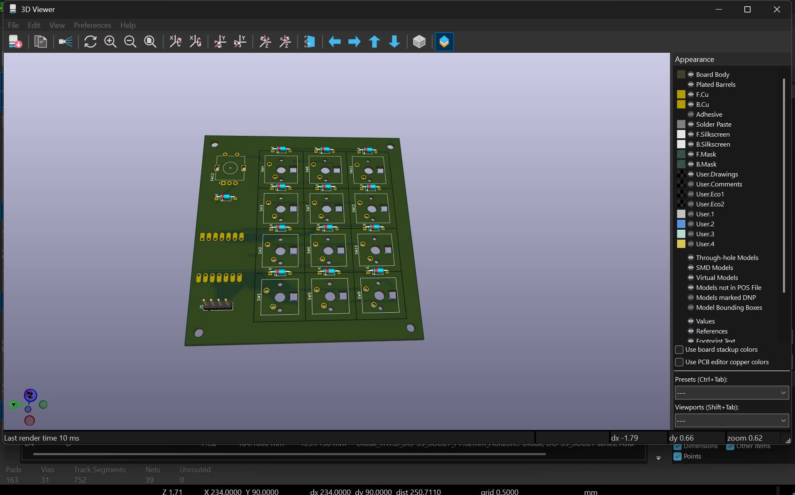

****# My_TechPad

- My OWN custom Macropad.

---

# Dream:

- What i plan , is to make a esthetic and slick hackpad which will have a the following features:
  1. The hackpad will have rgb lightning and will be connected to a device using wired connection(usb)
  2. it will have its own application which will allow to set commands and actions for the button
  3. it will be aesthetic black in colour with crazy lighting (customizable through app)
  4. i am planning to keep it simple and in devoloper theme.
  5. it will be a slick and esthetic desing, with 2 rotatory encoder, a oled screen , 12 keypads
  6. i dont plan on using anything extra or of my own .
  7. good animations for oled is also a requisite.
  8. as for the design i am planning , something of a
     - minimalist , slick , futuristc look
     - 3d printed mat finish
     - a usb port to connected to devices.

# desgin :

- I think my design is quite close to the image i had in my head.

1. it is slick and has a simplistic look.
2. black colour frame with rgb colouring.
3. Smooth finish
4. What more does a man need!!

# Screenshots:

- the whole thing put together:

- the schematic:

- the PCB:

# Specifications:

- I am planning to use all the items i will get under hackpad.

1. my hackpad will have 12 keys along with a rotary encoder knob.
   - 12 MX switches in a 4 x 3 grid, with white DSA keycaps.
   - 1 EC11 knob that you can also click. (the dream had 2 knobs, but i ran out of pins so one had to go. rip.)
2. the brain is a Seeed XIAO RP2040, plugged in with USB-C.
3. a tiny 0.91" OLED screen (128 x 32) on the top left. it shows which mode you're in, your typing speed (WPM) and the TechPad logo.
4. 12 RGB LEDs (SK6812 MINI-E), one under every key. they glow when you press a key and then fade out.
   - brightness is capped at 40%, because 12 LEDs at full blast would pull ~720 mA and USB only gives 500 mA. at 40% it's about 290 mA, so we're safe.
5. the XIAO only has 11 pins, so i couldn't wire the keys the normal way. i used a **duplex matrix** instead: 6 pins + 13 diodes read all 12 keys AND the knob click. no extra chips needed.
6. the PCB is 92 x 87 mm, 2 layers, with ground fill on both sides. 0 ERC errors and 0 DRC errors in KiCad.
7. the case is 3D printed in charcoal, in 3 pieces (bottom tray, switch plate, top frame). it's 98 x 93 x 22.4 mm, and the screws go in from the bottom so you don't see any on top.

# Firmware:

- built on QMK, but the key scanner (`matrix.c`) is all mine. it scans the matrix twice, once for each diode direction.

1. 3 modes: DEVELOPER, MEDIA and RGB.
2. click the knob to jump to the next mode.
3. turn the knob for volume (or LED brightness in RGB mode).
4. DEVELOPER mode has copy, paste, cut, undo, save, find, comment, VS Code commands, terminal, alt+tab, lock PC and mute.
5. MEDIA mode has play/pause, next and previous track, volume, screen brightness, calculator, browser and files.
6. RGB mode lets you switch the lights on/off, change effects, colour, brightness and speed.

- this modes are just a few basic things i am adding for now. in future i am planning to create my app to allow the user to customize the shortcuts and make his/hers own layers.The app can also be used to customize rgb and animations.lets hope all works out.....

# BOM:

- everything comes from the hackpad kit, except the PCB (made from my gerbers) and the 3D printed case. full list is in [Documentation/BOM.csv](Documentation/BOM.csv).

| Ref | Part | Qty | Where | Source |
|---|---|---|---|---|
| U1 | Seeed XIAO RP2040 (through-hole mount) | 1 | Back of PCB | Hackpad kit |
| SW1 to SW12 | MX-style mechanical switch | 12 | Top plate + PCB | Hackpad kit |
| - | White blank DSA keycap | 12 | On the switches | Hackpad kit |
| SW13 | EC11E rotary encoder with push switch | 1 | Top right | Hackpad kit |
| D1 to D13 | 1N4148 diode, DO-35 through-hole | 13 | Next to each switch | Hackpad kit |
| LED1 to LED12 | SK6812 MINI-E RGB LED (reverse mount) | 12 | Under each key | Hackpad kit |
| J1 + display | 0.91" I²C OLED module, 4-pin header | 1 | Top left | Hackpad kit |
| - | M3 × 16 mm screw | 4 | From underneath, through PCB corners | Hackpad kit |
| - | M3 × 5 × 4 mm heat-set insert | 4 | Underside of the top frame, at the corners | Hackpad kit |
| - | TechPad PCB, 92 × 87 mm, 2-layer | 1 | - | PCB fab (from gerbers.zip) |
| - | Top frame, switch plate, bottom tray, knob cap | 1 set | - | 3D printed |

# "How to build" A numbered list covering:

- Print: frame face-down, plate top-face-down with solid infill, tray floor-down, knob hole-side down. No supports.
- Heat-set inserts: 4 × M3 into the underside of the frame.
- Solder order: diodes (black stripe matches the silkscreen), XIAO on the back, LEDs, switches, encoder, then the - OLED raised about 3.5 mm on its pins.
- Assembly: stack tray, PCB, plate, frame, then fit 4 × M3×16 screws from underneath and push on the knob.
- Flash: hold the top-left key (or the XIAO BOOT button) while plugging in, then drag Production/firmware.uf2 onto the RPI-RP2 drive.
- Link Documentation/reference/05_After_Parts_Arrive.pdf for full details.

# Disclosure:
- Ai has Played a important part in the project for me. I have never designed pcb,step files or used QMK before this and Ai has acted as my gude solving this challanges.This section Provides a complete discloure of the places where ai has played a part:
1. To create the final design/product outlook upon which i have build my entire project.It is very important that one knows what one wants in the end. i have used ai to help me get a final image of the pad.
2. I have asked Ai to create me guides and explanation pdfs for every bit of project(can be found under documentation).This guides has helped me understand the stuff i was working on .
3.The schematic designs is all done by me , the footprints and all stuff. I have only asked claude to regularly review my files amd do  the final routing . i had already created the schematic and had to just join the wires.
4. In Case Design , i have used claude ai to create me the drawings upon which i have created the designs.Claude has also helped me create steps file by providing me with macros code.(it was very labour intensive and repeatative work so ya)
5. i can vouch for my 100% role in firmware devolpment. Claude has only acted as a mentor , and i have typed every peice of code.
6. lastly i have used claude to review my files so that they match each other and are not incomplete anywhere.

# Final Thanks and feedback:
-   I thank the enitre team of hackclub for organising such cool and wonderfull programs and allowing teens to bring there work on action. With this project i have learnt a lot and am planning to work on more projects as well.
- One thing i think you guys lack on is the clarity you guys are providing . like ,there are many times i have not recieved a proper reply which has left me confused .
